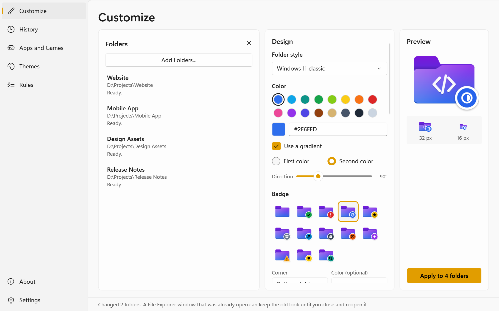
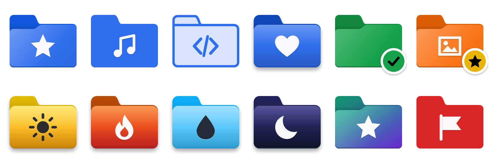
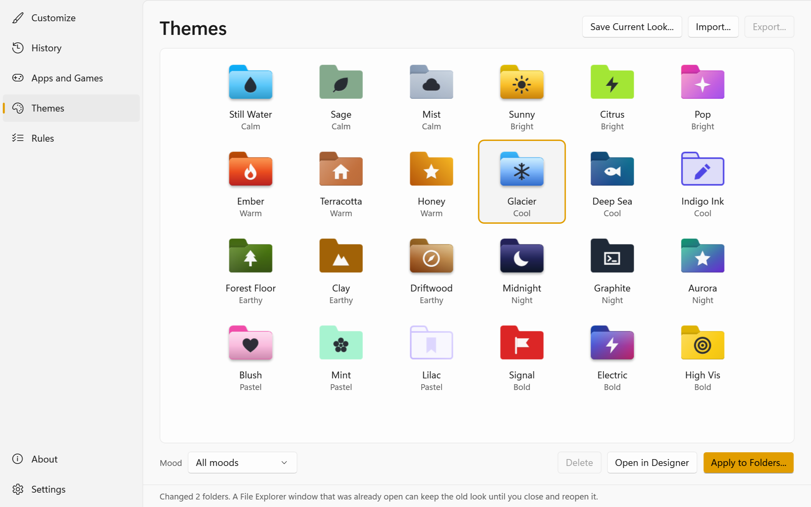
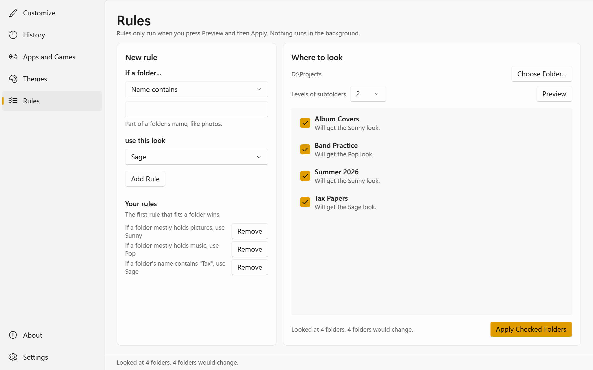
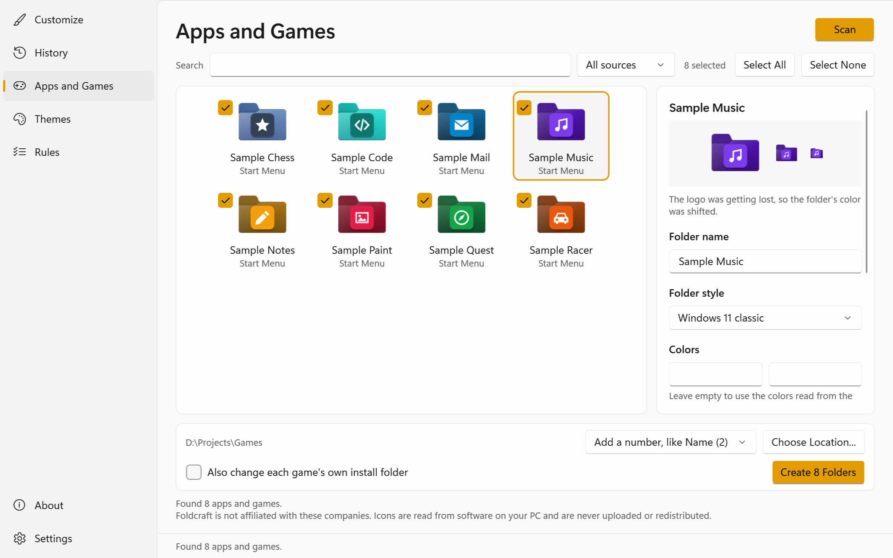
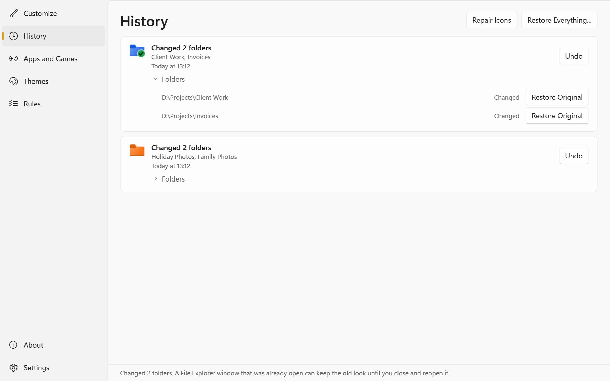

# Foldcraft

**Give your Windows 11 folders any look you like, and undo all of it whenever you want.**

<picture>
  <source media="(prefers-color-scheme: dark)" srcset="docs/images/customize-dark.png">
  
</picture>

## What it is

Foldcraft is a Windows 11 app that changes how folders look in File Explorer. Pick some folders and design a look with colors, symbols and badges. Then apply it. You can save looks as themes, set rules that match folders by name or contents and make matching folders for the apps and games it finds on your PC. One app's look can also go on every folder inside another folder at once, such as each version of that app.

Every change can be undone, and Foldcraft doesn't require administrator rights.

Foldcraft is at an early stage and has only been run on one Windows 11 PC.

<b>Screenshots</b> (click to read more)

| Themes | Rules |
| --- | --- |
|  |  |
| **Apps and games** | **History** |
|  |  |

## Download

1. Open the [latest release](https://github.com/28Y8/Foldcraft/releases/latest).
2. Under **Assets**, download `FoldcraftApp-win-Setup.exe`.
3. Run it. It installs for your account only and needs no administrator rights.
4. The installer isn't signed, so Windows SmartScreen may warn you. If it does, choose **More info** and then **Run anyway**.

Prefer not to install anything? Download the `.zip` from the same page, extract it and run `Foldcraft.exe`. That copy can't update itself.

If there's no release yet, [build it from source](CONTRIBUTING.md#getting-set-up).

## How it works

Windows already lets a folder have a custom icon, and Foldcraft uses that feature as it is:

1. **Draw:** your look becomes an icon file in Foldcraft's data folder, `%LOCALAPPDATA%\Foldcraft`.
2. **Check:** the folder goes through safety checks. Refused places include the Windows folder, Program Files, ProgramData, AppData, your main user folder, whole drives, network locations and anything reached through a link. Restarting as administrator from Settings allows folders inside Program Files and ProgramData.
3. **Record:** the change goes into an undo history first, including an exact copy of any existing `desktop.ini`.
4. **Write:** a small hidden `desktop.ini` file in the folder points to the icon, and the folder gets the mark that tells Windows to read it.
5. **Show:** the folder's date moves a tiny step (100 nanoseconds on NTFS), which makes the new look appear, and Foldcraft tells File Explorer that the folder changed.

Customized folders use the icons in the data folder, so press **Remove All Changes** in Settings before you delete it.

<b>What Foldcraft leaves alone</b> (click to read more)

Foldcraft never moves, renames, opens or edits anything else in a folder. It adds no shell extensions, patches no system files and never restarts Explorer. There's no service and nothing starts with Windows. Undo puts a folder back, along with its exact date unless the folder changed or needs a new preview.

<b>Updates and privacy</b> (click to read more)

Foldcraft contacts GitHub only to check for and download updates. It sends no personal data and no information about your folders, and GitHub sees your IP address, as any website does. You can turn the check off in Settings, and nothing downloads until you press **Update**. A finished download refreshes the updater (`Update.exe`) right away, and the app itself changes only after you agree to restart.

The full details and known limitations are in [how Foldcraft works](docs/how-it-works.md) and [how safety works](docs/safety.md).

## Copyright

Copyright (c) 2026 28Y8. Released under the [MIT license](LICENSE). What Foldcraft is built on is listed in [THIRD-PARTY-NOTICES.md](THIRD-PARTY-NOTICES.md).
